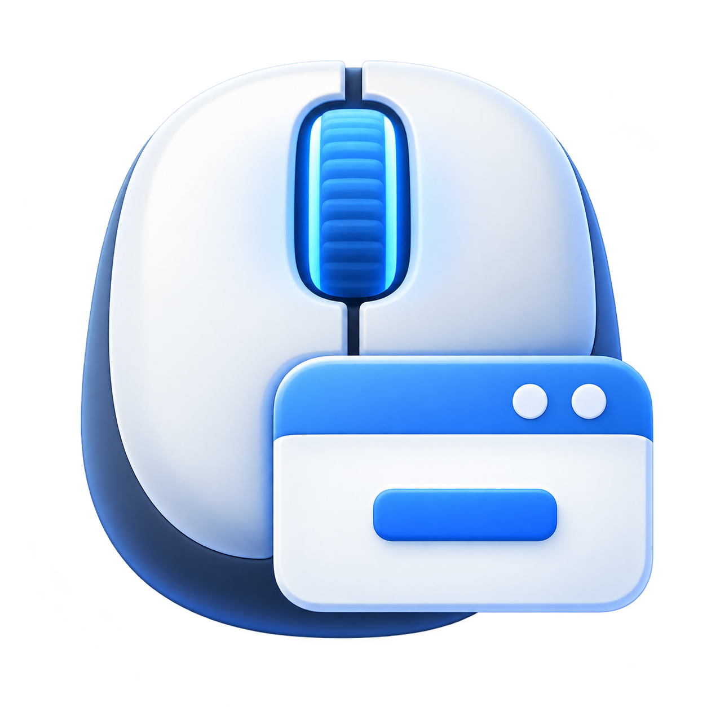

# Mac Middle



A small macOS menu bar app that lets you minimize a window by middle-clicking its title bar, just like GNOME. It works on the window under your pointer, even when another app is in front.

[Download the latest release](https://github.com/vitosans/mac-middle/releases/latest)

## Requirements

- macOS 13 or later, on Apple silicon or Intel.
- A mouse or input utility that sends a middle-button click.
- Accessibility permission to control windows in other apps.

## Install and use

1. Download the **Mac-Middle-v…-universal.zip** file from the [latest release](https://github.com/vitosans/mac-middle/releases/latest) and double-click it to unzip.
2. Drag **Mac Middle.app** to **Applications**, then open it there.
3. Allow **Mac Middle** in **System Settings → Privacy & Security → Accessibility**. If it is missing, click **+** and select the app from Applications.
4. Look for the mouse icon in the menu bar, then middle-click an empty part of a window's title bar or its title text. On most mice, pressing the scroll wheel sends a middle click.

The download is ad-hoc signed and is not notarized by Apple. If macOS blocks the first launch, open **System Settings → Privacy & Security**, find the message about Mac Middle, and choose **Open Anyway** if you trust this download. See [Apple's instructions](https://support.apple.com/en-us/102445).

Click the mouse icon in the menu bar to see the app's status. Use **Enabled** to pause or resume, **Grant Accessibility Permission…** to open the permission settings, and **Quit Mac Middle** to stop it. The app has no Dock icon or main window.

To start it at login, add the installed app under **System Settings → General → Login Items**. To uninstall, quit the app, remove its login item if present, and delete the app.

## Behavior and limits

- Requires a mouse or input utility that sends a real middle-button event (button 2).
- Uses public Quartz and Accessibility APIs; no administrator access or system modifications.
- Only consumes a middle click when minimizing succeeds. Other middle clicks pass through.
- Uses the window's minimize control to locate the title strip. Buttons, text fields, and other interactive elements are excluded.
- Custom title bars, browser tabs, and apps with incomplete Accessibility support may not work. Full-screen windows are excluded.

Compilation alone does not verify title-bar detection across apps. Check Finder, Terminal, Safari, and your usual apps after granting permission, and confirm middle clicks in page content and tabs keep their normal behavior.

## Troubleshooting

- **Accessibility permission required:** enable the app in Accessibility settings. If it is missing, add it with the settings panel's **+** button.
- **Unable to listen:** quit and reopen the app after granting permission.
- **Stopped working after a rebuild or move:** macOS may require you to remove the old Accessibility entry, add the current app, and reopen it.
- **Only some apps work:** custom title bars and incomplete Accessibility information can prevent detection. Try Finder or Terminal to distinguish an app-specific limitation from a permission issue.
- **Middle click does nothing:** confirm your mouse software sends a middle-button event rather than mapping the button to another action.

## Development

To build from source, install Xcode Command Line Tools (`xcode-select --install`), then run:

```sh
git clone https://github.com/vitosans/mac-middle.git
cd mac-middle
bash scripts/build.sh
open "build/Mac Middle.app"
```

The build script compiles Swift directly and creates an ad-hoc signed app at `build/Mac Middle.app`. It builds for the Mac's current architecture, generates the application icon from `mac-middle.png` using macOS tools, and requires no third-party dependencies. Use `bash scripts/build.sh --universal` to build for both Apple silicon and Intel.

GitHub Actions runs the unit tests, builds the app, validates its bundle metadata, and verifies its ad-hoc signature on a macOS runner for every push and pull request. You can also run the workflow manually from the repository's **Actions** tab. CI does not exercise global mouse input or real Accessibility responses.

CodeQL scans Swift code and GitHub Actions on pushes to `main`, pull requests, and weekly. Dependabot checks for action updates weekly. Report vulnerabilities privately using the [security policy](SECURITY.md).

## Publishing a release

1. Update `CFBundleShortVersionString` and increment `CFBundleVersion` in `Info.plist`.
2. Merge the changes into `main` after CI passes. From **Actions → Release → Run workflow**, run a packaging rehearsal on `main`; it uploads workflow artifacts without publishing a release.
3. On the checked commit, create and push a matching version tag:

   ```sh
   git tag -a v0.2.0 -m "Mac Middle v0.2.0"
   git push origin v0.2.0
   ```

The Release workflow checks that the commit belongs to `main` and the tag matches the app version, runs tests, builds a universal app, verifies the bundle, and publishes a GitHub release with the ZIP and SHA-256 checksum. Existing releases are not overwritten. Releases support stable `vMAJOR.MINOR.PATCH` tags.

To prepare the same files locally, run `bash scripts/prepare-release.sh`. Output is written to `build/release/`. Manually check real app behavior before tagging; automated checks do not exercise global input or Accessibility permissions.

| File | Purpose |
| --- | --- |
| `Sources/main.swift` | Menu bar UI, permission handling, mouse event tap, and Accessibility adapter. |
| `Sources/WindowInteraction.swift` | Testable click-sequence handling and title-bar detection. |
| `Tests/` | Unit tests using simulated Accessibility elements. |
| `Package.swift` | Dependency-free Swift Package Manager test configuration. |
| `Info.plist` | App identity, minimum macOS version, and menu bar app configuration. |
| `mac-middle.png` | Source image for the README and bundled application icon. |
| `scripts/build.sh` | Compile, bundle, and ad-hoc sign the app. |

Run the unit tests without launching the app or granting Accessibility permission:

```sh
swift test
```

The tests cover successful and failed minimization, matching drag/release suppression, other mouse buttons, reset behavior, title-bar geometry, interactive controls and tabs, missing Accessibility attributes, full-screen exclusion, background-window targeting, and bounded ancestor traversal. They use simulated Accessibility trees and do not verify real apps or global event delivery.

After changes, build and validate the bundle:

```sh
bash scripts/build.sh
plutil -lint Info.plist
codesign --verify --strict --verbose=2 "build/Mac Middle.app"
```

For input or window-detection changes, also verify these behaviors manually:

- Title-bar middle clicks minimize Finder and Terminal windows, including a background window.
- Middle clicks in browser content and tabs retain their normal behavior.
- Left, right, and side-button clicks retain their normal behavior.
- Disabled mode stops minimizing windows; re-enabling restores it.
- Full-screen windows and title-bar controls are excluded.

Unit tests complement the manual checks above. Passing them and building successfully does not establish live compatibility with individual apps.
